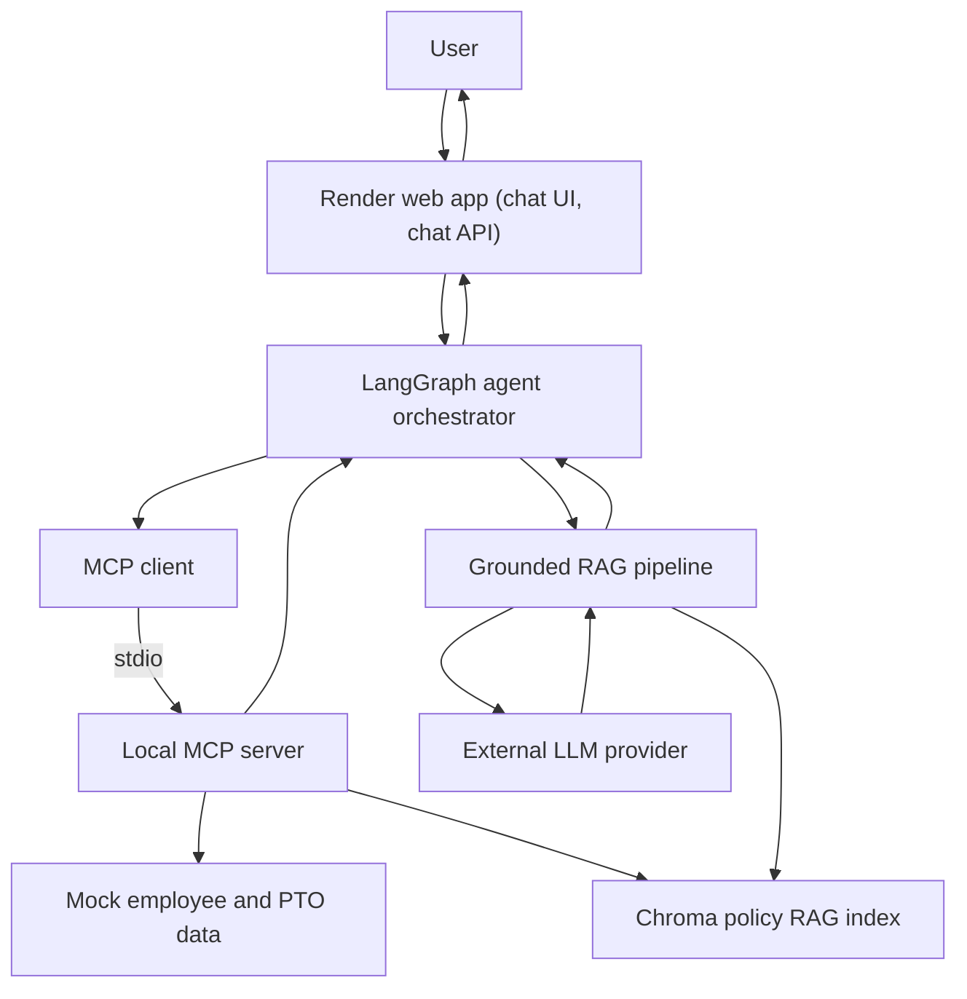

# Northstar HR Agent Design and Evaluation

This document describes the completed architecture, RAG and MCP design, safety guardrails, evaluation set, and measured results for the Northstar HR Agent project.

## Section 9: Agentic RAG Evaluation

The evaluation suite contains 25 machine-readable cases covering policy Q&A, multi-document questions, tool-requiring workflows, ambiguous requests, and out-of-scope or unsafe requests.

### Evaluation Artifacts

- [Evaluation set](evaluation/northstar_section9_evaluation_set.json)
- [Final consolidated results](evaluation/results/section9_consolidated_final_results.json)
- [Final evaluation report](evaluation/results/section9_final_report.json)
- [Test documentation](evaluation/northstar_section9_evaluation_test_documentation_final.docx)
- [Evaluation instructions](evaluation/README.md)

### Final Results

| Metric | Result |
| --- | ---: |
| Evaluation cases | 25/25 passed |
| Groundedness | 100% across 22 applicable cases |
| Citation accuracy | 100% across 22 applicable cases |
| Gold-answer partial match | 71.49% mean |
| Tool-selection accuracy | 100% |
| Workflow completion | 100% |
| Clarification or escalation accuracy | 100% |
| Action-safety pass rate | 100% |
| Automated tests | 63 passed |

Applicable evaluation metrics appear in the chatbot's **Agent Trace**, including answer quality, agent behavior, safety, latency, run condition, retrieval configuration, and evaluation case.

The primary evaluation run completed 23 cases; two additional attempts were interrupted by confirmed retrieval-service failures and were marked Not Scored. Those two cases were rerun after service recovery. All 25 cases passed their criteria on completed, scored attempts. The interrupted attempts remain documented as reliability evidence. The 71.49% gold-answer partial match is a supplementary lexical-overlap measure, not an answer-correctness rate; semantically equivalent wording and required context can lower the score. The 100% results apply to the 22 cases where the corresponding metrics were applicable.

### Latency and Free-Tier Behavior

A 15-query representative baseline measured approximately 10,240 ms at p50 and 15,924 ms at p95. Cold-start and warm-start measurements are reported separately in the evaluation results. These are application request timings; the separate Render wake-up delay after spin-down can be longer.

Confirmed external quota, rate-limit, timeout, or provider-connectivity interruptions are classified as **Not Scored**, not as incorrect answers. Interrupted attempts are rerun when service becomes available and remain preserved as system-reliability and safe-handling evidence.

### Retrieval Ablation

The `k=3` configuration passed 91.67% of 12 representative cases, while `k=5` passed 100%. The application retains `k=5` because it produced stronger groundedness, citation accuracy, and gold-answer coverage, with higher documented latency.

### Run the Evaluation

The full evaluation consumes external language-model tokens:

`python scripts/run_evaluation.py --mode baseline --delay-seconds 8 --service-retries 1 --retry-backoff-seconds 60`

Run the automated tests without consuming language-model tokens:

`pytest -q`

## Section 10: Design Documentation

### 10.a Design choices

#### 10.a.1 Agent framework and orchestration

Northstar uses LangGraph to orchestrate its agent workflows. The workflows need to route between policy-only questions and multi-step PTO or remote-work requests, carry state between steps, and record an operational trace. A graph makes these branches and handoffs explicit, which supports testing and troubleshooting. Deterministic application logic handles safety decisions, while the language model generates grounded responses.

#### 10.a.2 MCP server design and transport

The MCP server exposes policy retrieval and mock HR data or action functions as tools, while reusing the existing application functions for their business logic. The agent connects to this local server as a subprocess over `stdio`. This transport fits the single-service Render deployment: the web app, agent, and MCP server run in the same project environment, so a separate network service and port are unnecessary. MCP still gives the agent a defined tool boundary.

#### 10.a.3 MCP client discovery and calls

The client initializes an MCP session with the local server, calls `list_tools()` to discover tool names, descriptions, and input schemas, and invokes selected tools by name with structured arguments. It normalizes tool results for the agent workflows.

#### 10.a.4 MCP tool schemas

All five MCP tools return structured data. Policy tools return ranked matches with source metadata; their `top_k` argument defaults to 5 and must be between 1 and 10. The tool contracts are:

- `search_policy_documents(query: string, top_k: integer = 5)` searches policy evidence by meaning.
- `get_policy_section(section: string, policy_title: string | null = null, top_k: integer = 5)` retrieves evidence filtered by section and, optionally, policy title.
- `lookup_employee_profile(work_email: string | null = null, full_name: string | null = null)` looks up one employee using a work email or exact full name.
- `check_pto_balance(employee_id: string | null = null, work_email: string | null = null)` retrieves one employee's PTO balance.
- `mock_submit_pto_request(employee_id: string | null = null, start_date: string | null = null, end_date: string | null = null, requested_days: number | null = null, confirmed: boolean = false)` previews or simulates a PTO request; confirmation is required for the mock action, and no real HR record is changed.

Policy tools return controlled statuses such as `ok`, `not_found`, `invalid_request`, and `unavailable`, so the agent can distinguish results from errors and missing evidence.
Narrow, typed arguments keep calls predictable, and the bounded `top_k` limits request size.

#### 10.a.5 Embedding model

The project uses Chroma's local default embedding function, `all-MiniLM-L6-v2`, to embed both policy chunks and search queries. It produces 384-dimensional vectors, keeping document and query embeddings compatible while avoiding a separate paid embedding API.

#### 10.a.6 Chunking strategy

Policy documents are split into overlapping, token-aware chunks with a maximum size of 200 tokens. PDF chunks retain their page references, and CSV chunks retain their row references. Chunk metadata records source and section information so retrieved passages can be cited and traced back to the original material.
Overlap preserves context across chunk boundaries, while the size limit keeps passages focused and source-location metadata supports citations.

#### 10.a.7 Retrieval k

Policy retrieval defaults to `k=5`, returning the five highest-ranked chunks. This provides several passages to ground an answer while keeping the context manageable. The MCP policy tools accept values from 1 through 10 when a workflow needs a narrower or broader result set.

#### 10.a.8 Vector store

ChromaDB stores the policy vectors and citation metadata in the local `chroma_db/` directory and uses cosine distance for similarity ranking. Its local persistence fits the project's policy corpus and works with Chroma's local embedding function, without requiring a separately hosted vector database.

#### 10.a.9 Deployment architecture

The application is deployed as a single Render web service that hosts the chat UI, chat API, LangGraph orchestrator, MCP client, and local MCP server process. The MCP server starts over `stdio` within the service. Mock employee and PTO data remain in the project, and the Chroma index is built from the committed policy documents during deployment. The application calls the configured OpenAI-compatible LLM provider using environment-based settings. This single-service layout keeps the deployment and operations simple without requiring a separate MCP host, vector database, or production HR system.

#### 10.a.10 Safety guardrails

The agent answers policy questions from retrieved Northstar sources, and application code validates citations against those sources. It applies a relevance check before generation and can return an insufficient-evidence response when support is missing. Retrieved documents are treated as reference data rather than instructions. Employee data is limited to supported HR workflows, sensitive matters can be escalated, and the mock PTO action requires explicit confirmation. The system never claims that a mock action changed a real HR record.

### 10.b Architecture

The web app, orchestrator, MCP client and server, mock data, and Chroma index run within the Render service. The LLM provider is called externally. MCP policy tools and the grounded RAG pipeline can both retrieve policy evidence from the Chroma index.
### 10.c Demo tasks and MCP call sequences

#### 10.c.1 PTO request guidance

Demo prompt: Can I take three days of PTO next week?

Expected sequence:
1. Call `lookup_employee_profile` with the user work email or exact full name.
2. If the employee is identified, call `check_pto_balance` using the work email returned by the profile lookup.
3. Run the grounded RAG pipeline to retrieve PTO policy evidence. In this workflow, policy retrieval is separate from the MCP calls. The pipeline sends the retrieved passages to the configured LLM, which generates the cited response.
4. Use the balance and policy evidence to explain eligibility, approval requirements, and next steps.

If the user later asks to submit a mock request, call `mock_submit_pto_request` only after explicit confirmation. The mock action does not change a real HR record.

#### 10.c.2 Remote-work eligibility

Demo prompt: May I work remotely from another state or country for six weeks?

Expected sequence:
1. Call `lookup_employee_profile` with the user work email or exact full name.
2. If the employee is identified, run the grounded RAG pipeline to retrieve applicable remote-work, security, tax or location, and approval policies. Policy retrieval is separate from the MCP call in this workflow.
3. The configured LLM uses the employee profile and retrieved policy evidence to generate cited guidance and next steps.
4. If the evidence is incomplete or the case requires approval, explain the limitation and direct the employee to the appropriate HR or manager contact.

Expected MCP call trace: `lookup_employee_profile` with the supplied work email or full name, followed by the returned employee profile. The policy sources and citations appear in the RAG trace.
